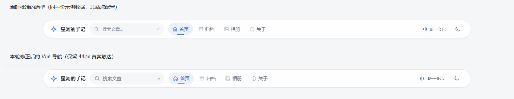

# 导航还原度与前后端功能复查

- 日期：2026-10-16
- 初次检查对象：`9e7358a`；随后按用户「继续」确认的范围修正当前工作区
- 状态：**导航纠偏与已复现缺陷已修复，自动化、真实联调及独立代码复核通过**

以下第 1、2 节保留修复前的证据，不代表问题仍然存在。修复设计原存于 `docs/superpowers/specs/2026-10-16-navigation-fidelity-correction-design.md`（该目录已于 2026-10-19 清理），修复结果以本记录第 3 节与 [CHANGELOG.md](../../CHANGELOG.md) 为准。

## 1. 导航与已批准原型的差异

基准是用户批准的组合修订版（B 的空间结构、A 的纵向列表及参考站紧凑导航），不是最初的 A/B/C 草稿。

使用相同站名「星河的手记」、主色 `#3e76cb` 和已启用的音乐配置，在 Chrome 对照原型与 Vue 页面；检查宽度为 1440、1024、768、390、320px。

| 项目 | 批准原型 | 当前实现 | 结论 |
| --- | --- | --- | --- |
| 桌面外框 | 高 52px、顶距 16px、宽度上限 1200px | 一致 | 不需要重做外框尺寸 |
| 搜索后的导航分组 | 链接紧接搜索，空白在链接与右侧工具之间 | 空白放在搜索与链接之间 | **主要布局偏差**；1440px 下第一个链接从 x=471 移到 x=885 |
| 当前项 | 34px 高的浅蓝细长胶囊、短下划线 | 36px 高、8px 圆角的矩形、短下划线 | 选中形状偏离原型 |
| 音乐入口 | 静止声条 +「听一会儿」 | 音符 +「音乐」，播放时才显示声条 | 未按批准的入口视觉实现 |
| 音乐面板 | 54px 渐变图标块、播放键右侧循环、细音量轨道 | 44px 浅色图标块、循环在左、额外说明文字、原生滑轨 | 布局和视觉层级均有偏差 |
| 手机工具 | 原型触达宽约 34px | 实现保留 44px 触达 | 还原视觉时保留可用性改进，不直接缩小触达区域 |

源码根因：`Navbar.vue` 把 `margin-left: auto` 放在 `.nav-links`；原型把它放在右侧 `.tools`。

**修正后**：弹性空白已移到右侧工具前，1440px 下第一个链接 x=472（原型 x=471），不再是 x=885。选中填充恢复 34px 胶囊，但链接/音乐工具真实触达为 44px；恢复四角星默认标记（上传 Logo 仍优先）、静止声条＋「听一会儿」、54px 图标块及循环键右置。音乐轨道依据真实媒体值绘制，并补充高对比系统色降级；不会恢复原型的假时长。



配置差异需单独处理：当前本地后端为默认主色 `#165DFF`，且 `musicEnabled=false`、没有音源。音乐入口按现有契约隐藏并非渲染失败；不得为了截图一致，暗中更改作者配置或使用原型假音频/假时长。上传 Logo 也应继续优先于内置图标。

## 2. 已复现的功能问题

### 2.1 后台抽屉：尺寸切换后残留滚动锁与焦点限制

- 文件：`frontend/src/views/admin/AdminLayout.vue`
- 复现：390px 打开菜单 → 改为 1440px → 连续 Tab。
- 实际：`mobileOpen` 仍为真，`body.style.overflow=hidden`，焦点循环在侧栏内；桌面下关闭/菜单按钮却已消失。
- 关联问题：关闭的手机侧栏只被 transform 移出屏幕；Shift+Tab 仍可聚焦屏幕外链接。菜单的 `aria-controls="admin-sidebar"` 也没有对应 ID。
- 修正边界：仅手机抽屉拥有模态焦点/滚动生命周期；进入桌面释放状态，手机关闭时不参与键盘导航，保留正常桌面侧栏。
- 修复结果：Chrome 复验关闭侧栏 inert，Shift+Tab 不再进入屏幕外链接；切到桌面后展开状态为假、body 滚动恢复，Tab 能到达工作区，aria-controls 目标存在。

### 2.2 发布成功后仍弹出未保存提示

- 文件：`frontend/src/views/post/PostEdit.vue`
- 复现：真实登录 → 写文章 → 保存草稿 → 确认发布。
- 实际：创建文章和删除草稿都返回 200，内容已持久化；跳转却被原生「有未保存的更改，确定要离开吗？」打断。取消提示会留在编辑器，可能误导作者再次发布。
- 原因：发布成功没有更新 `dirty`，手动保存草稿也没有使当前已保存内容变为干净状态；已有单测直接挂载组件而非通过 RouterView，未真实执行离开守卫。
- 修正边界：以实际提交的内容快照判断保存状态；请求期间产生的新改动仍必须保留警告。失败请求不得清除未保存保护；避免成功后自动保存再次生成已删除的草稿。
- 修复结果：完整内容快照（含摘要、标签）替代遗漏字段的 dirty 标志。真实发布后没有多余原生确认；失败请求和请求期间新改动继续受保护。草稿写入与发布互斥；发布期间继续编辑则留在编辑器，下次更新已创建的文章而非重复创建。

### 2.3 标签长度前后端不一致

- 文件：`frontend/src/views/admin/TagsManagement.vue`、`backend/src/main/java/com/selfblog/controller/admin/AdminTagController.java`
- 实际：新建/编辑输入框允许 40 字，后端限制 20 字；真实 21 字请求返回 400。
- 修正边界：前端输入与提示遵循既有 20 字规则，保留后端校验，不提高服务端上限。
- 修复结果：新建/编辑均限制 20 字，程序提交也先校验；服务器失败原因保留。真实浏览器与后端上限一致。

## 3. 自动化回归结果

| 检查 | 初次检查 | 修正后 |
| --- | --- | --- |
| 前端类型检查 | 通过 | 通过 |
| 前端单测 | 30 文件 / 328 测试 | 31 文件 / 345 测试通过 |
| ESLint | 0 错误 / 271 警告 | 0 错误 / 255 警告 |
| 前端生产构建 | 通过 | 通过 |
| 后端测试 | 463 / 0 失败 / 0 错误 / 0 跳过 | 同样通过 |

执行命令：

```powershell
# frontend/；使用仓库 provisioned Node 的 PATH
npm run type-check
npm run test:run
npm run lint:check
npm run build

# backend/；JDK 21，使用本机可用的 Maven 3.9.12
mvn test '-Dskip.npm=true' '-Dskip.installnodenpm=true'
```

后端测试必须保留两个 skip 参数，否则会触发前端安装/构建。测试全绿不能证明视觉符合原型，也没有覆盖本次新增的浏览器边界场景。

## 4. 真实服务联调

使用当前源码编译产物启动独立 Spring Boot（仅监听 `127.0.0.1:18825`），新建临时 SQLite、测试管理员及上传目录。Chrome 页面运行实际 Vue 代码，API/上传请求透明转发到该实例，不用模拟响应。现有 8825 服务、数据库及上传目录未被写入；检查后已终止独立服务。

初次 15 个工作流断言中 **13 项通过、2 项失败**，失败项对应发布后误报和标签长度差异。修正后这 15 项通过，再增加「取消确认焦点」和「恢复文章草稿不重复创建」两个复核场景，最终 **17/17 通过**。计数来自脚本报告数组；无多余原生确认，不是靠接受/忽略错误弹窗把结果改成通过。

通过的检查包括：

- 匿名管理/文章写入被拒绝，注册返回明确 403。
- 管理员真实登录；文章发布即公开，详情、搜索及标签查询可读取。
- 浏览器保存草稿、确认发布、文章落库与草稿删除；修正后无需多余的未保存提示即可跳转。
- 匿名点赞、留言落库，以及管理员隐藏留言后公开列表不再展示。
- 密码相册上传、锁定元数据、错密码拒绝、令牌解锁、未授权图片拒绝；浏览器照片与灯箱可用，Esc 只关闭灯箱。
- 音乐上传、公开文件访问、设置持久化；真实音频播放、公开换页保持同一音频元素、进入后台暂停。
- 浏览器设置修改、保存和刷新后值保留。
- RSS、Atom、sitemap 与 robots 可访问，订阅/收录数据包含测试文章。
- 浏览器工作流无脚本错误、无 HTTP 5xx。

修正后的发布检查无需接受多余提示即可跳转；另外通过真实 RouterView 单测验证保存期间新改动、失败请求、发布/自动保存竞争及重发不重复创建。导航以七档宽度（320/390/768/820/960/1024/1440px）对照，另检查深色、减少动效、自定义主题与高对比模式；高对比滑轨曾以截图像素断言复现完全消失，修复后再验证可见。

**未覆盖**：真实 MySQL 实例、Docker 构建、SMTP/重置邮件投递、外部音频站点及 iOS 真机。不得将 SQLite 联调结果写成所有部署环境均通过。

## 5. 文档校正范围

- 根/前端 README：链接本报告，区分已交付实现、原型偏差与待修复问题。
- 后端 README：补充真实 SQLite 联调的范围与未验证项，不编造后端功能变更。
- 设计规格和三份实施计划：上一轮状态仍为「实施中」或未勾选，后续按实际证据同步；不能简单全部勾选。
- 指南中的 `/uploads → /api/uploads` 开发代理描述已过期；当前 `vite.config.ts` 原样代理 `/uploads`。
- 版本表需区分 package.json 的依赖范围与 package-lock 的锁定版本，避免把范围下界写成实际运行版本。

## 6. 独立代码复核

只读复核首次提出两项 P2：恢复草稿没有还原文章 ID，以及发布确认打开前禁用按钮导致取消后焦点丢失。两项均先用失败测试复现，再修复；复核者随后通过 48 项定向测试和独立 Chrome 检查确认关闭，没有发现本轮新的具体回归。真实服务联调另由主流程验证，不混用替身浏览器结论。

只对本轮修改的 11 个源码/测试文件运行 Prettier，检查通过；未运行仓库级 format。根 CLAUDE.md 的既有修改未覆盖、未混入本轮代码。

本轮未改后端接口/数据库；是否推送不以本报告代替实际操作记录。
