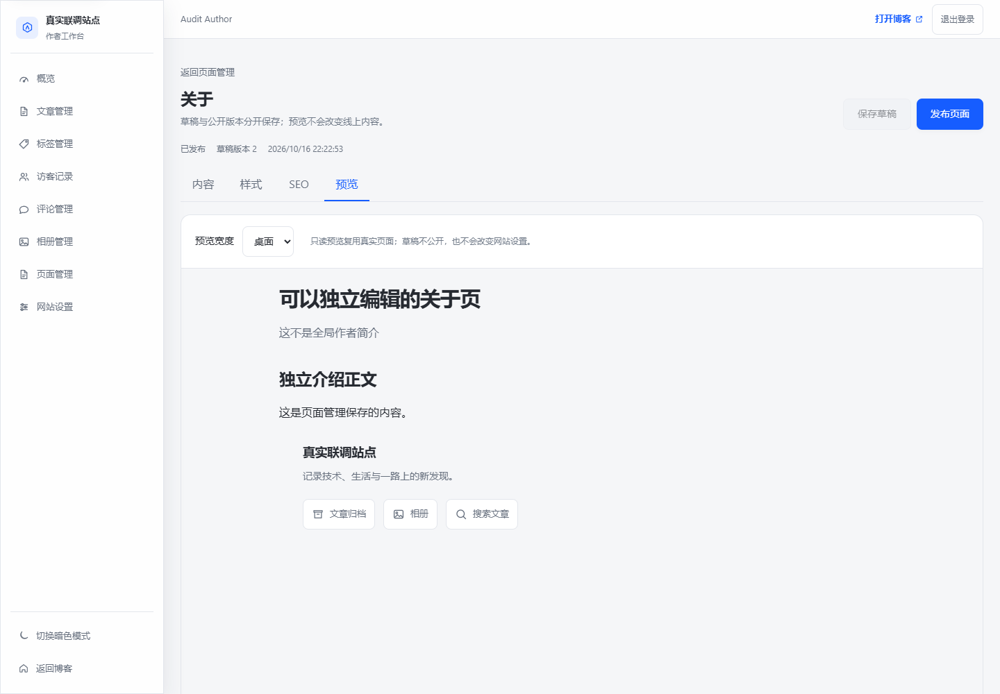

# 页面管理验证记录（2026-10-16）

## 范围与结果

本批实现已批准的[公开页面管理规格](../superpowers/specs/2026-10-16-configurable-public-pages-design.md)：8类内置页/模板配置、About独立正文、自建内容页、草稿/发布分离、受控样式、真实组件预览和公开导航。**没有实施全站放大，也没有修改数据库schema或现有数据。**

| 检查 | 实际结果 |
| --- | --- |
| 前端完整单测 | 41文件 / 389测试通过 |
| 前端类型 / Lint / 构建 | 通过；Lint0错误 / 256警告（含净化后v-html的提示） |
| 本轮源码/测试格式 | 仅检查/格式化本轮文件，通过；未运行全仓库format |
| 后端完整单测 | 491测试 / 0失败 / 0错误 / 0跳过 |
| 独立事务并发 | H2两项通过：相同revision竞争写入、相同slug同时创建，各只有一个成功 |
| 单JAR打包 | `backend/target/selfblog.jar`构建成功，内嵌最新frontend/dist |
| 真实SQLite/Chrome工作流 | **31/31通过**；服务由实际`selfblog.jar`启动，含生产包直连、手机/深色预览及首屏请求顺序 |
| 原导航/音频回归 | 320/390/768/820/960/1024/1440px通过，导航仍50/52px，工具至少44px，无页面错误 |

## 已覆盖的业务证据

- 原有17项真实服务工作流继续通过：作者登录、文章/草稿发布、公开查询、匿名点赞/留言、审核、密码相册、上传音乐与跨公开页连续播放、进入后台暂停、设置保存和订阅源。
- About通过真实后台保存草稿；新访客仍看到旧内容。预览能看到未发布的独立Markdown正文，发布后访客才读取新内容；没有覆盖全局作者简介。
- 新建内容页初始404，保存不等于发布；发布后可通过`/pages/<slug>`访问并加入公开导航。过期页面/导航版本返回409，已发布slug修改返回400。
- 9项较长导航在七档宽度不挤压右侧工具、不产生横向页面溢出；多余项进入「更多」，Escape关闭，手机菜单保留全部。
- 每页强调色只写在页面根内；切到后台后meta为noindex。Markdown脚本/事件属性被净化，iframe预览不会改变公开页面或管理页的head。
- 下线/删除不影响文章与相册；公开接口和作者导航编辑均过滤不可用目标，避免编辑导航时带回已下线的链接。
- 单JAR直连浏览器完成真实登录、后台预览与自建内容页读取，内嵌静态资源正常加载；响应仍为`X-Frame-Options: DENY`，srcdoc预览没有依赖安全降级。
- 390px后台编辑与预览无整页横向溢出，iframe随作者深色主题更新。另用明确隔离的视觉数据验证局部强调色、760px宽度、纸感深色与forced-colors的Canvas降级；这项样式校准不混记为真实数据库工作流。
- 两个全新访客上下文分别延迟真实摘要和真实正文响应，验证摘要先到/正文先到都能保留About已发布正文；透明转发响应，不用替身数据掩盖请求顺序。

## 界面证据

以下截图来自隔离测试站点，内容为测试数据，并非写入作者现有博客：

## 先复现、再修复的边界

1. 相同页面保存期间的新修改不能被旧响应标为已保存。
2. 保存期间切到另一个编辑页后，新页不能永久busy；新页加载失败也不能留下旧页的可提交表单。
3. 创建页面后晚返回的响应不能把已离开的作者拉回编辑器。
4. 导航409后的重新加载需先确认，不能直接丢弃本地标签文字。
5. 预览不能只把桌面div变窄：使用真实390px视口，Chrome验证媒体查询和移动端padding。
6. 预览错误的「重试」不能放进inert内容；只读区域与恢复控制分开。
7. 运行时metadata要清理旧文章/JSON-LD，明确清空的说明不能残留；预览、缺失、搜索、404、后台的noindex不受作者错误覆盖影响。
8. 初始配置摘要和About正文并行返回时，不能互相丢弃：同一发布版本保留/补入正文，新发布版本缺失正文时重新加载；旧版响应仍不能覆盖较新元数据。新增三项回归均先失败再修复。

## 联调断言修正记录

首轮扩展联调为24/27，不直接写成通过：

- 生产JSON会省略null字段，因此列表body应断言“不存在或null”，不是强制出现null。
- Escape先改变展开状态，再进行离场过渡；等待inert离场节点脱离，不要求同步销毁DOM。
- 末尾反复读取公开文章列表触发既有10次/分钟限流；改用管理员列表确认文章未被页面删除操作影响，没有放宽生产限流。

修正的是验证契约，不是忽略错误；随后27/27通过，再扩展到真实单JAR、UI确认下线/删除、手机/深色预览和首屏请求顺序，最终31/31通过，无脚本错误、HTTP5xx或意外原生确认。

## 复核与限制

独立只读复核子任务因额度限制中断，**没有独立复核通过结论**。主流程完成逐项源码复查，并对发现的实际问题补失败回归再修复。

真实联调用全新临时SQLite和上传目录，进程退出后关闭；没有向现有8825服务或其数据库写入。单测为H2，不代表真实MySQL验证。Docker、SMTP、外部媒体、iOS真机和真实公网部署未验证。

本批SEO是页面配置与运行时meta生命周期，**尚未解决初始HTML正文、站点地图100篇上限、规范公网域名、Docker构建和Vercel路由欠项**。这些属于后续独立批次，不能宣称博客已被搜索引擎收录。

## 可复跑闸门

从frontend运行`npm run type-check`、`npm run test:run`、`npm run lint:check`、`npm run build`；使用本仓库provisioned Node，环境见AGENTS.md。

从backend以JDK21运行Maven：`test -Dskip.npm=true -Dskip.installnodenpm=true`；已有前端构建后执行`package -DskipTests -Dskip.npm=true -Dskip.installnodenpm=true`检查单JAR打包。

Chrome真实联调脚本和含临时凭据的运行目录只保留本地，不作为仓库CI入口或部署脚本；本文区分实际执行结果与可直接复跑的仓库测试。
